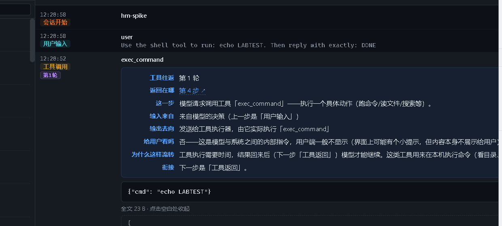
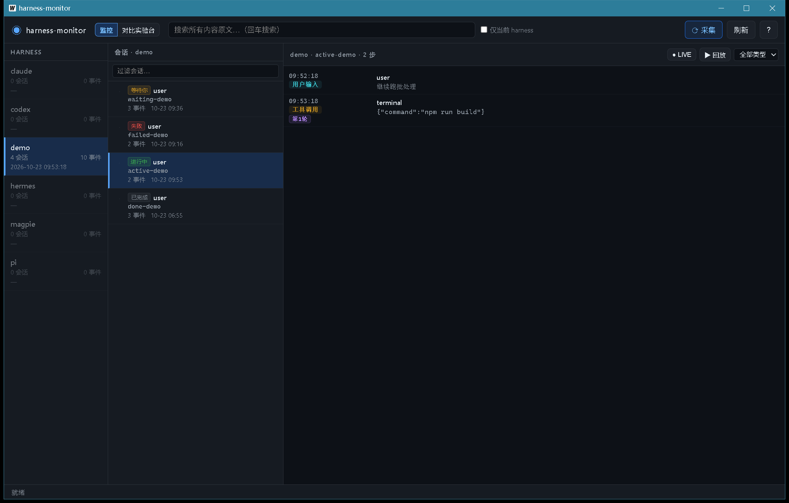

# harness-monitor

本地 AI coding harness 的统一观测与对比工具（Go + Wails v2 桌面应用）。

两个核心功能：

- **监控** — 采集本机各 AI coding harness 的步骤级事件流：从用户输入开始，到会话执行完毕，每一步（用户输入 / 模型推理 / 工具调用参数 / 工具结果）**内容级可见**（不是只记 token）。按 harness 独立、按会话独立。
- **对比实验台** — 一个问题并发发给多个 harness，各自独立运行、分别记录、并列显示，方便对比同一问题下不同 harness 的处理过程。


## 目标 harness

Hermes · Codex · Claude Code · pi（另采集 magpie 网关用量）

## 使用

双击 `harness-monitor.exe` 启动 GUI。

### 监控视图（三级导航：harness → 会话 → 时间线）


- 点开任一步骤：内容全文 + 自然语言说明（这一步是什么 / 输入来自哪 / 输出去向 / 是否显示给用户 / 为什么流转到下一步）
- **工具往返配对**：一次工具调用的「请求」和「返回」常常不相邻（实测本机库里 codex 有 1198 次、hermes 709 次、pi 189 次的结果落在调用之后 5 步以上，最长一次隔了 11685 步）。配对后每步会标出「第 N 轮工具往返」，展开即见「返回在哪 / 调用在哪」并一键跳转对齐；工具结果还能从调用侧补回真名（此前 25% 的工具结果只显示「未知工具」）

  
- **会话用量 / 成本合计**：时间线顶部一条用量条，给出该会话的输入 / 输出 / 缓存 / 推理 token、合计、费用、失败调用数与分模型明细。五家的记录形态不同（codex 的累计计数器按 rollout 文件重置且会话恢复时会继承上游基数、hermes 是「会话×模型」汇总、claude 是每会话一条 cost-state、pi/magpie 是逐次调用），合计规则集中在 `internal/usage`；费用字段缺失时显示「费用未知」而不是 `$0`（「没报」不等于「免费」）
- **失败/异常可见**：失败的步骤此前和成功的长得一模一样（一次退出码 1 的命令在时间线上没有任何标记），现在卡片上直接带红色徽标（「错误」/「失败·退出码 1」）。信号全部取自各家记录的结构化字段，不做正文猜测：codex 的 `turn_aborted`（回合被中断，实测 17 条）、claude 的 `api_error` 重试记录与 `isApiErrorMessage` 合成行（HTTP 502，实测 30 条）、pi 的 `stopReason=error`（模型调用失败，实测 244 条，含 429 限流/401 鉴权/上下文超限）、hermes 工具结果的 `exit_code` 非 0 或非空 `error` 字段（实测 1358 条）、pi 工具结果的 `isError`（实测 995 条）。说明层会讲清「失败在哪一层、意味着什么」（如「接口失败后系统通常会自动重试」），筛选器选「错误」即可只看失败步骤
- **会话置顶**：常用会话点 📌 钉在列表顶部（可多个，按置顶时间倒序），不再被新会话挤下去；置顶存在独立的 `session_pins` 表，清库重采不丢失
- 搜索所有内容原文（回车搜索，命中后跳转定位）
- LIVE 跟随（增量采集 + 自动刷新）、回放（逐步查看）、按类型过滤

### 对比实验台

- 输入一个问题，勾选 harness（默认四家全选），点「开始对比」
- 四列并列实时更新：状态徽标 / 耗时 / token 用量 / 费用 / 步骤时间线 / 最终回答
- 运行中可「停止」；历史批次随时回看

### 会话导出（CLI）

把任一会话导出成自包含的 Markdown 文件——每一步含完整内容与自然语言说明书（含工具往返配对、失败标记），可直接阅读、归档或分享：

导出默认开启脱敏：内容里的个人路径（`C:\Users\…`）、邮箱、API 密钥会被替换为 `[已脱敏:…]` 占位符（文首注明替换处数），分享导出文件不再带走本机隐私；要原文导出加 `--no-redact`：

```bash
hm export <harness> <session-id>          # 输出到 exports/<harness>-<sid前8位>.md（默认脱敏）
hm export hermes 20261005_132047_a2ca7c -o 会话.md
hm export hermes 20261005_132047_a2ca7c --no-redact   # 原文导出
```

### 全文检索（CLI）

不开 GUI 直接搜本地库的会话内容——对标 sessiongrep 的「从命令行搜会话」能力（这里复用 GUI 搜索的同一套匹配逻辑，无需单独建索引）：

```bash
hm search "git push"                      # 搜全部 harness，命中按 harness → 会话 分组
hm search "水位" --harness hermes         # 只搜某家
hm search "proxy" --limit 50 --context 0  # 限命中数；context=0 只显示内容开头
```

每条命中给出时间 / 类型 / 标题和命中点上下文窗口（单条内容可达数 MB，窗口让你一眼看到命中处）；要读全文再 `hm show <harness> <session-id> --full`。

### 跨会话统计（CLI）

不开 GUI 一眼看全局——对标 sniffly / token-dashboard 首页的概览面板：规模、用量、工具热点、失败原因四个维度：

```bash
hm stats                            # 全部 harness 的统计报告
hm stats --harness hermes           # 只看某家
hm stats --top 20                   # 工具与失败原因各列前 20 条
```

报告给的是**跨 harness 可比**的数字，不是各家自报值的直接相加——各家的 token 口径不同（codex 的输入字段本身含缓存命中、pi 的合计含缓存、hermes/claude 的合计不含），直接相加得到的总数不是同一把尺子。因此：

- **处理 token** = 新输入 + 缓存读 + 输出（统一口径，报告里的三项之和恒等于总数）
- **新输入** = 不含缓存命中的部分（codex 的输入要扣掉缓存命中）
- **工具失败**只认各家自己上报的结构化字段（`meta.is_error`）；「判不了」（工具结果不带失败信号，如 codex/claude）与「没失败」分开报，不混为一谈

### 重复调用环（CLI）

找出「同一个动作卡在原地反复做」——同一条命令、同一个参数，在同一个会话里被调用了 N 次。对标 MINDLAS 的 tool loop / rungraph 的 retry storm：`hm stats` 只能回答「失败了多少次」，答不了「是不是在打转」，而后者才是 agent 空转最常见的样子。

```bash
hm loops                            # 全部 harness，阈值 3
hm loops --harness hermes           # 只看某家
hm loops --threshold 5              # 同一组重复 5 次以上才算打转
hm loops --top 50                   # 列出前 50 组
```

判定口径与 `hm stats` 一致：

- **重复**是结构事实（同一会话 + 同一工具 + 同一组参数），不依赖失败信号 → 对五家 harness 一视同仁，codex/claude 也能查出来
- **次数按调用标识（`call_id`）去重**：同一次调用被重复采集时不会算成两次调用
- **失败**只认各家自己上报的 `meta.is_error`；codex/claude 的工具结果不带该字段，报告显示「-」而不是假装「没失败」
- 实测本机库（23 万事件 / 66 万次工具调用）：阈值 3 命中 367 组、涉及 126 个会话；阈值 5 命中 96 组

### 会话当前状态（CLI + GUI）

一眼看出**哪个会话正等着你回答、哪个刚失败**——对标 tmux-agent-sidebar 的状态列（needs permission / 等待原因）与 MioIsland 的待批准提醒。

```bash
hm status                           # 默认只列「要你出手」的会话（等待 + 失败）
hm status --all                    # 列出全部会话的状态
hm status --harness codex          # 只看某家
```

GUI 的会话列表每一项都带状态标记，需要你出手的会话自动排到最前：



五种状态：**等待你**（问了但没得到回答）/ **失败**（最后一步是 error）/ **进行中**（90 分钟内还有动作）/ **已完成**（有 turn.end / session.end 终态标记）/ **空闲**。

判定口径（只认结构化事实，不猜正文）：

- **「等你回答」** = 存在一个「等人回答类」的工具调用（hermes 的 `clarify`、pi 的 `ask_user_question`、claude 的 `AskUserQuestion`、codex 的 `request_user_input` / `request_permissions`），且这次调用**没拿到回答**，且**用户在这之后没再说过话**（否则说明 agent 已经往下走了）
- **「失败」**只认 `error` 事件；**「已完成」**只认 `turn.end` / `session.end`
- 「用户答了」各家的回答形态不同（hermes 是 JSON 的 `responses[].user_response`、pi 是 `User has answered your questions: ...`、codex 是 `{"answers":{...}}`），都按实际形态解析；**解析不出来就说判不了**，不把「看不懂」当成「没回答」

实测本机库：7 个会话在等回答、18 个以失败告终。

## 数据来源

各 harness 的本地会话存储（只读采集，增量续读）：

| 数据源 | 位置 | 格式 |
|---|---|---|
| Hermes | `~/AppData/Local/hermes/state.db` | SQLite |
| Codex | `~/.codex/sessions/**/*.jsonl` | JSONL rollout |
| Claude Code | `~/.claude/projects/**/*.jsonl` | JSONL |
| pi | `~/.pi/agent/sessions/**/*.jsonl` | JSONL |
| magpie | `~/.config/magpie/usage.jsonl` | JSONL |

数据统一入库到 `data/hm.db`（SQLite，事件表带 source_key 幂等去重）。环境变量 `HM_DATA_DIR` 可覆盖数据目录。

## 构建（Windows / git-bash）

前置：Go 1.21+、Wails v2 CLI（`go install github.com/wailsapp/wails/v2/cmd/wails@latest`）、WebView2 Runtime。

```bash
# CLI 版
go build ./... && go vet ./...
go build -o bin/hm.exe ./cmd/hm

# GUI 版（必须用 wails build；普通 go build 会因 build tags 报错）
cd gui && wails build

# 测试
go test ./... -count=1
```

## 架构

```
cmd/hm             CLI 入口（采集/查询）
gui/               Wails v2 桌面应用（绑定层 + 静态前端）
internal/collect   五路采集器（增量续读、幂等入库）
internal/store     SQLite 存储（事件库 + 对比实验台三表）
internal/explain   自然语言步骤说明生成器（含工具往返配对）
internal/export    会话导出为 Markdown（内容 + 说明书自包含）
internal/usage     会话用量/成本合计（五家记录形态归一）
internal/runner    四家 harness 非交互运行器 + 输出解析器
internal/compare   对比实验台编排（并发运行、增量写库、停止）
```

## 文档

- `docs/DESIGN.md` — 设计文档 + 统一事件 kind 规范
- `docs/DESIGN-runner.md` — 对比实验台设计规格（含四家命令与解析映射）
- `docs/DATA-FORMATS.md` — 各数据源实测格式
- `docs/tool-calling-explained.md` — 工具调用机制说明（用真实数据还原）

## 备注

- 采集是只读的，不修改任何 harness 的存储。
- 对比实验台在独立目录（`data/runs/<run_id>/<harness>/`）里运行各 harness，隔离副作用。
- 若上层环境设置了 `HTTP_PROXY`（如本地代理），运行器会自动把回环地址合并进 `NO_PROXY`，避免对本地网关的请求被误发到代理。
