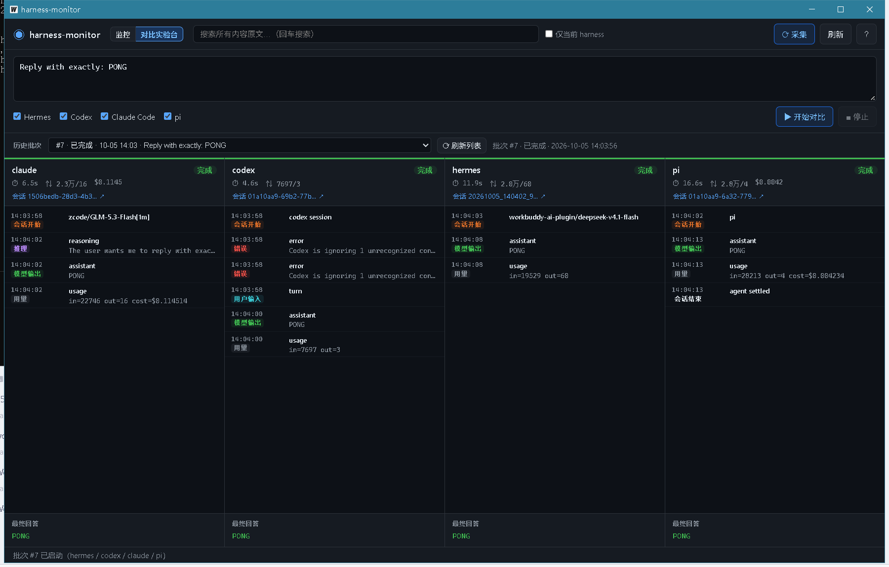
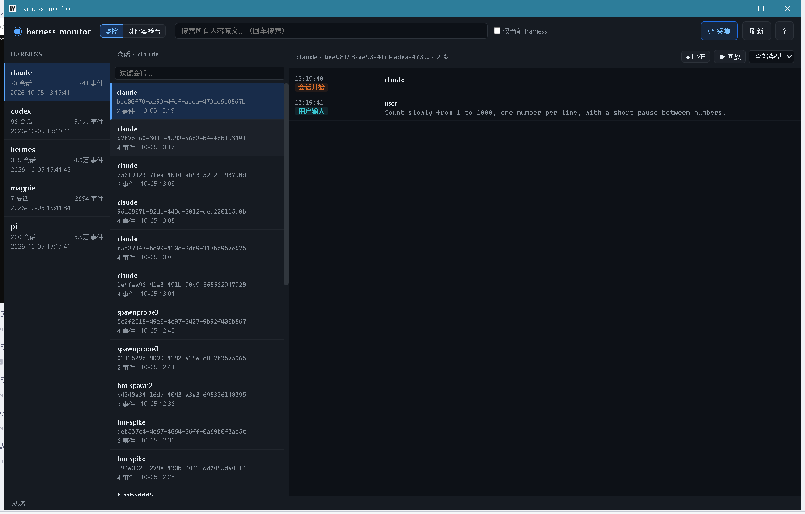

# harness-monitor

本地 AI coding harness 的统一观测与对比工具（Go + Wails v2 桌面应用）。

两个核心功能：

- **监控** — 采集本机各 AI coding harness 的步骤级事件流：从用户输入开始，到会话执行完毕，每一步（用户输入 / 模型推理 / 工具调用参数 / 工具结果）**内容级可见**（不是只记 token）。按 harness 独立、按会话独立。
- **对比实验台** — 一个问题并发发给多个 harness，各自独立运行、分别记录、并列显示，方便对比同一问题下不同 harness 的处理过程。



## 目标 harness

Hermes · Codex · Claude Code · pi（另采集 magpie 网关用量）

## 使用

双击 `harness-monitor.exe` 启动 GUI。

### 监控视图（三级导航：harness → 会话 → 时间线）



- 点开任一步骤：内容全文 + 自然语言说明（这一步是什么 / 输入来自哪 / 输出去向 / 是否显示给用户 / 为什么流转到下一步）
- 搜索所有内容原文（回车搜索，命中后跳转定位）
- LIVE 跟随（增量采集 + 自动刷新）、回放（逐步查看）、按类型过滤

### 对比实验台

- 输入一个问题，勾选 harness（默认四家全选），点「开始对比」
- 四列并列实时更新：状态徽标 / 耗时 / token 用量 / 费用 / 步骤时间线 / 最终回答
- 运行中可「停止」；历史批次随时回看

## 数据来源

各 harness 的本地会话存储（只读采集，增量续读）：

| 数据源 | 位置 | 格式 |
|---|---|---|
| Hermes | `~/AppData/Local/hermes/state.db` | SQLite |
| Codex | `~/.codex/sessions/**/*.jsonl` | JSONL rollout |
| Claude Code | `~/.claude/projects/**/*.jsonl` | JSONL |
| pi | `~/.pi/agent/sessions/**/*.jsonl` | JSONL |
| magpie | `~/.config/magpie/usage.jsonl` | JSONL |

数据统一入库到 `data/hm.db`（SQLite，事件表带 source_key 幂等去重）。环境变量 `HM_DATA_DIR` 可覆盖数据目录。

## 构建（Windows / git-bash）

前置：Go 1.21+、Wails v2 CLI（`go install github.com/wailsapp/wails/v2/cmd/wails@latest`）、WebView2 Runtime。

```bash
# CLI 版
go build ./... && go vet ./...
go build -o bin/hm.exe ./cmd/hm

# GUI 版（必须用 wails build；普通 go build 会因 build tags 报错）
cd gui && wails build

# 测试
go test ./... -count=1
```

## 架构

```
cmd/hm             CLI 入口（采集/查询）
gui/               Wails v2 桌面应用（绑定层 + 静态前端）
internal/collect   五路采集器（增量续读、幂等入库）
internal/store     SQLite 存储（事件库 + 对比实验台三表）
internal/explain   自然语言步骤说明生成器
internal/runner    四家 harness 非交互运行器 + 输出解析器
internal/compare   对比实验台编排（并发运行、增量写库、停止）
```

## 文档

- `docs/DESIGN.md` — 设计文档 + 统一事件 kind 规范
- `docs/DESIGN-runner.md` — 对比实验台设计规格（含四家命令与解析映射）
- `docs/DATA-FORMATS.md` — 各数据源实测格式
- `docs/tool-calling-explained.md` — 工具调用机制说明（用真实数据还原）

## 备注

- 采集是只读的，不修改任何 harness 的存储。
- 对比实验台在独立目录（`data/runs/<run_id>/<harness>/`）里运行各 harness，隔离副作用。
- 若上层环境设置了 `HTTP_PROXY`（如本地代理），运行器会自动把回环地址合并进 `NO_PROXY`，避免对本地网关的请求被误发到代理。
